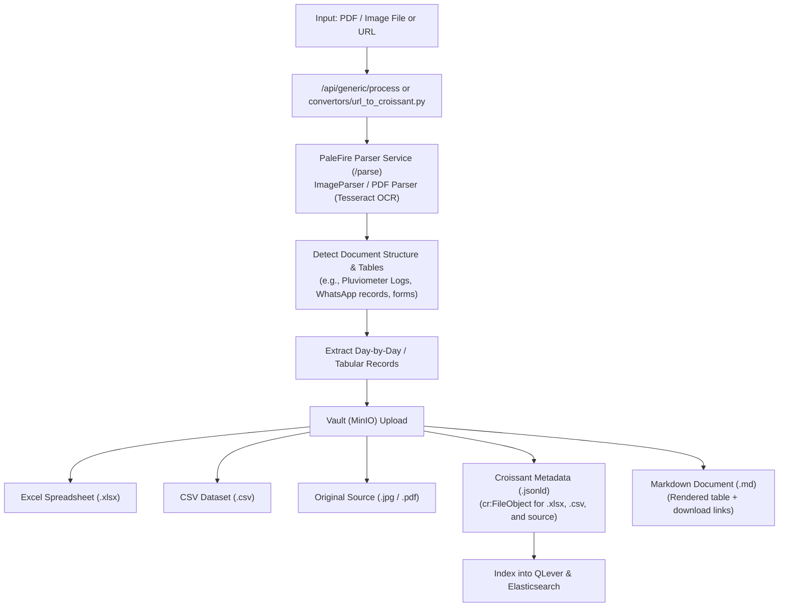

# AGENTS.md — Semantic Croissant Agent Guidelines

This document provides operational guidelines for AI agents interacting with the **Semantic Croissant** ecosystem.

---

## 1. Platform Overview

Semantic Croissant is a live semantic database backed by [QLever](https://github.com/ad-freiburg/qlever) (SPARQL), Elasticsearch (full-text), and MinIO (Vault storage). It exposes a **Model Context Protocol (MCP)** server with 20+ tools for dataset discovery, content generation, variable extraction, vault persistence, and provenance tracking.

**Public MCP Endpoint**: `https://mcp.dev.codata.org/mcp`
**Production Dashboard**: `https://ai.codata.org/`

---

## 2. Identity & Authentication (DIDs)

All agents acting in this environment SHOULD identify themselves through a **Decentralized Identifier (DID)**.

- **Identity File**: Check `~/.odrl/authorize` for the current authentication token.
- **DID Resolution**: The ODRL Wallet at `https://odrl.dev.codata.org/vcs` manages DIDs.
- When saving to the Vault, the system automatically embeds the DID in the `creator` and `service` verification blocks of the Croissant JSON-LD.
- If your client does not expose identity via MCP `clientInfo`, provide your AI vendor/model name via the `ai_model_override` parameter when calling `save_to_vault`.

---

## 3. Available MCP Tools

### Onboarding (Call First)
| Tool | Description |
|---|---|
| `onboarding` | **Must be called before any other tool.** Returns guidance on which tools to select based on user intent. |
| `planner` | Navigation guide for optimal tool sequencing. |

### Dataset Discovery
| Tool | Description |
|---|---|
| `search_croissant_datasets` | Search the QLever graph with natural language keywords. |
| `get_croissant_dataset` | Get full Croissant JSON-LD for a dataset by ID or URL. |
| `read_croissant_file` | Read the contents of a specific file from a Croissant dataset's distribution. |
| `elasticsearch_fulltext_search` | Full-text search across all indexed datasets. |
| `ask_expert` | Query a specific expert index: `sshoc`, `croissant`, `dataverse`, `ollama`, `huggingface`, `openml`, `hips`, `honduras`. |

### Content Generation & Ingestion
| Tool | Description |
|---|---|
| `url_to_croissant` | Convert any URL (web, YouTube, Google Sheets batch) or document (PDF, image, CSV, Excel) to Croissant JSON-LD. |
| `describe_resource` | Describe any resource (file or URL) → Croissant JSON-LD + summary. |
| `process_generic` | Generic ingestion API (`/api/generic/process` & `/api/generic/upload`) for processing PDF, image, spreadsheet, and URL assets into Excel, CSV, Croissant metadata, and Vault storage. |
| `ingest_to_qlever` | Ingest JSON-LD into the QLever database. |

### Vault Operations
| Tool | Description |
|---|---|
| `save_to_vault` | Save content + Croissant JSON-LD to the Vault. **You MUST generate the JSON-LD automatically.** |
| `read_vault_article` | Read a Vault document by filename, ID, or URL. |
| `list_vault_documents` | List all Vault files (optional prefix filter). |
| `update_vault_document` | Create a new version with provenance links to source documents. |
| `verify_document_provenance` | Verify DID signatures and list all creators. |

### Variable & Key Figure Extraction
| Tool | Description |
|---|---|
| `extract_variables_from_croissant` | Extract column names/descriptions from a Croissant dataset. |
| `extract_variables_from_oai` | Extract variables from OAI_ORE/Dataverse exports. |
| `extract_keyfigures` | Extract ALL numerical data points from text → CSV. |
| `finalize_keyfigures` | Convert CSV → Croissant JSON-LD and save to Vault. **Must be called after `extract_keyfigures`.** |

### Collections & Groups
| Tool | Description |
|---|---|
| `search_collections` | Query for user-created Collections. |
| `search_groups` | Query for user-created Groups. |
| `get_collection_documents` | List documents in a specific Collection. |
| `build_collection_from_expert` | Macro: query expert → create Collection → fill with results. |

### Hazard Information Profiles
| Tool | Description |
|---|---|
| `hazards_info_profile` | Retrieve UNDRR HIPs metadata and codes. |
| `hazards_translation` | Get translated hazard profiles by language. |

### External Integrations
| Tool | Description |
|---|---|
| `google-drive` | Search, read, or upload files to Google Drive. Operations: `search`, `read`, `upload` (supports `suggest_mode`). |
| `search_web` | Web search (only exposed to Claude Desktop clients). |

### Available Prompts
| Prompt | Description |
|---|---|
| `extract_keyfigures` | Prompt used to extract numerical facts and key figures from a block of text. |

---

## 4. Critical Agent Rules

### 4.1 — Vault Saving Protocol
When saving dataset summaries, analytical results, or updating documents in the Vault (using `save_to_vault` or `update_vault_document`):
1. You **MUST** automatically generate complete Croissant JSON-LD metadata.
2. Do **NOT** wait for the user to ask — generate it proactively.
3. Do **NOT** truncate the JSON-LD payload or use placeholders like `"...rest of variables..."`.
4. Include your AI model identity via `ai_model_override` if MCP `clientInfo` is not available.

### 4.2 — Key Figures Workflow
1. Call `extract_keyfigures` to extract numerical data from text.
2. You **MUST** then call `finalize_keyfigures` with the CSV output.
3. This saves the key figures as a Croissant JSON-LD dataset to the Vault with full provenance.

### 4.3 — Dataset Metadata Display
When retrieving dataset metadata via `get_croissant_dataset`, you **MUST** format and display the details (Title, Description, Creator, URL, etc.) in readable Markdown to the user.

### 4.4 — Variable Extraction with OpenML
When extracting variables from an OpenML dataset, you **MUST** provide the full HTTP URL (e.g., `https://www.openml.org/d/46729`), **NOT** just the numeric ID.

### 4.5 — Expert Index Search Strategy
When users ask to search for datasets generally:
1. Start with the most relevant expert index (e.g., `dataverse`, `openml`).
2. If insufficient results, try querying other indexes.
3. Use `extract_variables_from_croissant` on each found dataset for detailed variable info.

### 4.6 — Provenance & Attribution
- When creating content that references Vault documents, use `update_vault_document` to establish explicit provenance links.
- All creators (human and AI) are tracked in the Croissant metadata.
- UNF-6 fingerprints guarantee content integrity and deduplication.

---

## 5. Agent Configuration

Agent settings are managed in `agents/agent.config`:

```json
{
  "OLLAMA_HOST": "http://10.147.18.82:11435",
  "MODEL": "gemma4:e4b",
  "MCP_URL": "http://localhost:7070/sse",
  "ai_model_override": "Semantic Croissant AI Agent v.0.1"
}
```

| Key | Description |
|---|---|
| `OLLAMA_HOST` | Ollama inference server endpoint |
| `MODEL` | LLM model to use (e.g., `gemma4:e4b`) |
| `MCP_URL` | MCP server SSE endpoint |
| `ai_model_override` | Attribution string for Vault metadata |

---

## 6. Agent Skills (`.agents/skills/`)

| Skill | Description |
|---|---|
| `build-croissant-live` | Build and deploy the Croissant-Live stack via Docker Compose. |
| `manage-semantic-croissant` | Manage, deploy, and execute the data conversion pipeline. |

---

## 7. Croissant Toolkit Skills (`croissant-toolkit/`)

The embedded [Croissant Toolkit](https://github.com/codata/croissant-toolkit) provides Gemini-powered skills:

| Skill | Description |
|---|---|
| `wizard` | Auto-navigate, transcribe, and structure web content into Croissant JSON-LD. |
| `nlp-expert` | Extract named entities and inject them into dataset metadata. |
| `croissant-expert` | Enforce MLCommons Croissant schema constraints. |
| `ro-crate-expert` | RO-Crate metadata generation and validation. |
| `odrl-expert` | ODRL policy management and DID resolution. |

---

## 8. Data Pipeline & File Processing (PDF / Image → Excel, CSV & Croissant)

### 8.1 Ingestion Methods Overview

| Method | Command / Tool | Description |
|---|---|---|
| Generic Process API | `POST /api/generic/process` | Ingest local path, image, PDF, or URL → outputs `.xlsx`, `.csv`, `.jpg`/`.pdf`, `.jsonld`, `.md` in Vault |
| Generic File Upload API | `POST /api/generic/upload` | Multipart file upload for image or document ingestion |
| CLI Conversion | `python3 convertors/url_to_croissant.py <file_or_url> --elastic --host <host>` | Direct CLI ingestion pipeline |
| Batch Conversion | `python3 pipeline/convert_all.py <dir> <out.nt>` | JSON-LD → NTriples |
| Live Ingestion | `POST /add_record` or `ingest_to_qlever` tool | Zero-downtime append to QLever |
| Full Rebuild | `POST /rebuild` | Background index rebuild |
| URL Scraping | `url_to_croissant` tool | Web → Croissant JSON-LD |
| Google Sheets Batch | `url_to_croissant` with Sheets URL | Process all URLs from spreadsheet |

---

### 8.2 Processing PDFs & Images to Excel, CSV, and Croissant

When processing document files (PDFs, scanned images, monitoring sheets, tabular photos), the pipeline employs OCR, table extraction, and Croissant generation to produce structured data formats.

#### 1. Pipeline Architecture


#### 2. Key Steps in Document & Image Processing
1. **PaleFire Image & PDF Parsing**:
   - The document or image is submitted to the PaleFire API endpoint (`http://palefire-api:8000/parse`).
   - PaleFire's `ImageParser` runs Tesseract OCR (`lang='spa+eng'` or configured language) and checks for structured data sheets (e.g. Bioversity/CIAT community rainfall monitoring sheets, rainfall tables, or accompanying chat records).
   - The parser returns a `ParseResult` with structured `tables` (`headers` and `rows`) and metadata (e.g. community, municipality, observer, year, month).
2. **Generating Excel & CSV Datasets**:
   - Extracted table rows and headers are mapped into Pandas DataFrames.
   - For every extracted table, the pipeline serializes both:
     - **CSV**: `{doc_id}.csv` (`text/csv`)
     - **Excel**: `{doc_id}.xlsx` (`application/vnd.openxmlformats-officedocument.spreadsheetml.sheet`)
   - Both files are uploaded to the MinIO `vault` bucket.
3. **Persisting the Original File**:
   - The original image (`.jpg`, `.png`, etc.) or PDF (`.pdf`) is preserved and uploaded to the `vault` bucket as `{doc_id}.{ext}` so raw source data remains accessible.
4. **Croissant JSON-LD Distribution Creation**:
   - Each generated file is registered as a `cr:FileObject` in the Croissant `distribution` block:
     ```json
     "distribution": [
       {
         "@type": "cr:FileObject",
         "@id": "{doc_id}.xlsx",
         "name": "{doc_id}.xlsx",
         "description": "Spreadsheet of daily measurements",
         "contentUrl": "https://{host}/vault/{doc_id}.xlsx",
         "encodingFormat": "application/vnd.openxmlformats-officedocument.spreadsheetml.sheet",
         "sha256": "..."
       },
       {
         "@type": "cr:FileObject",
         "@id": "{doc_id}.csv",
         "name": "{doc_id}.csv",
         "description": "CSV dataset of daily measurements",
         "contentUrl": "https://{host}/vault/{doc_id}.csv",
         "encodingFormat": "text/csv",
         "sha256": "..."
       },
       {
         "@type": "cr:FileObject",
         "@id": "{doc_id}.jpg",
         "name": "{original_filename}",
         "description": "Original source file",
         "contentUrl": "https://{host}/vault/{doc_id}.jpg",
         "encodingFormat": "image/jpeg",
         "sha256": "..."
       }
     ]
     ```
5. **Markdown Document Generation**:
   - The markdown document (`{doc_id}.md`) includes a `# Citation` header with relative links to:
     - Croissant Metadata (`./{doc_id}.jsonld`)
     - Spreadsheet (`./{doc_id}.xlsx`)
     - CSV Data (`./{doc_id}.csv`)
     - Original file (`./{doc_id}.jpg` / `./{doc_id}.pdf`)
   - Displays a day-by-day Markdown table and summary metrics in the body.

#### 3. API & CLI Usage Examples

**A. Ingest via Generic Process API (Local path or URL)**:
```bash
curl -s -X POST "http://localhost:7013/api/generic/process" \
  -H "Content-Type: application/json" \
  -d '{
    "url": "test/Conversa do WhatsApp com Red Pluviómetros Honduras/IMG-20230820-WA0000.jpg",
    "host": "ai.mediaquantum.eu"
  }'
```
Response:
```json
{"status":"success","redirect_url":"/vault/doc/1E42cdW7E3BKHAW33F0Law.md"}
```

**B. Ingest via Direct File Upload (Multipart Form)**:
```bash
curl -s -X POST "http://localhost:7013/api/generic/upload" \
  -F "file=@/path/to/document.pdf" \
  -F "host=ai.mediaquantum.eu" \
  -F "vision=true"
```

**C. Direct CLI Execution**:
```bash
python3 convertors/url_to_croissant.py \
  "test/Conversa do WhatsApp com Red Pluviómetros Honduras/IMG-20230820-WA0000.jpg" \
  --elastic \
  --host "ai.mediaquantum.eu"
```

#### 4. Accessing Generated Vault Assets
Vault assets are accessed at:
- Markdown Viewer: `https://{host}/vault/doc/{doc_id}` (or raw: `/vault/doc/raw/{doc_id}.md`)
- Croissant JSON-LD: `https://{host}/vault/{doc_id}.jsonld`
- Excel Spreadsheet: `https://{host}/vault/{doc_id}.xlsx`
- CSV Dataset: `https://{host}/vault/{doc_id}.csv`
- Original Source: `https://{host}/vault/{doc_id}.jpg` (or `.pdf`)

---

## 9. Connecting to the MCP Server

### SSE (Cursor, Windsurf)
```json
{
  "mcpServers": {
    "croissant-mcp": {
      "type": "sse",
      "url": "https://mcp.dev.codata.org/mcp"
    }
  }
}
```

### Streamable HTTP
```
POST https://mcp.dev.codata.org/mcp
```

### stdio (Claude Desktop, Zed)
```json
{
  "mcpServers": {
    "croissant-local": {
      "command": "docker",
      "args": ["exec", "-i", "croissant-live-mcp", "python", "/app/mcp_server.py"]
    }
  }
}
```

### Remote via `mcp-remote` bridge (Zed, Claude Desktop)
```json
{
  "command": "npx",
  "args": ["-y", "mcp-remote", "https://mcp.dev.codata.org/mcp"]
}
```

---

## 10. Testing

- **Test Suite**: 68 test scripts in `tests/`.
- **Runner**: `python3 tests/run_all_tests.py`
- Tests cover: MCP tools, API endpoints, Elasticsearch, MinIO, Vault, URL conversion, OAI parsing, Claude integration, Google Drive, agents, Ollama performance, and more.

---

## 11. Security & Integrity

- **ODRL/DID Authentication**: OAuth → ODRL Wallet → DID anchored in Croissant metadata.
- **UNF-6 Fingerprinting**: Content-based hashing for deduplication and integrity.
- **Digital Signatures**: DID + UNF-6 hash combined into verification blocks.
- **FAIR Signposting**: HTTP `Link` headers on all Vault responses for machine-actionability.
- **SHACL Validation**: `shapes/croissant.ttl` and `shapes/odrl.ttl` for schema enforcement.

---

## 12. Deployment Profiles

| Profile | File | Description |
|---|---|---|
| `croissant-live` | `profiles/croissant-live.env` | Default development profile |
| `codata` | `profiles/codata.env` | CODATA production |
| `codata-dev` | `profiles/codata-dev.env` | CODATA development |
| `ca4eosc` | `profiles/ca4eosc.env` | Climate-Adapt4EOSC |
| `cdif4eosc` | `profiles/cdif4eosc.env` | CDIF4EOSC |

Each profile is fully sandboxed: QLever indexes, Elasticsearch volumes, and MinIO data are isolated by profile name.
